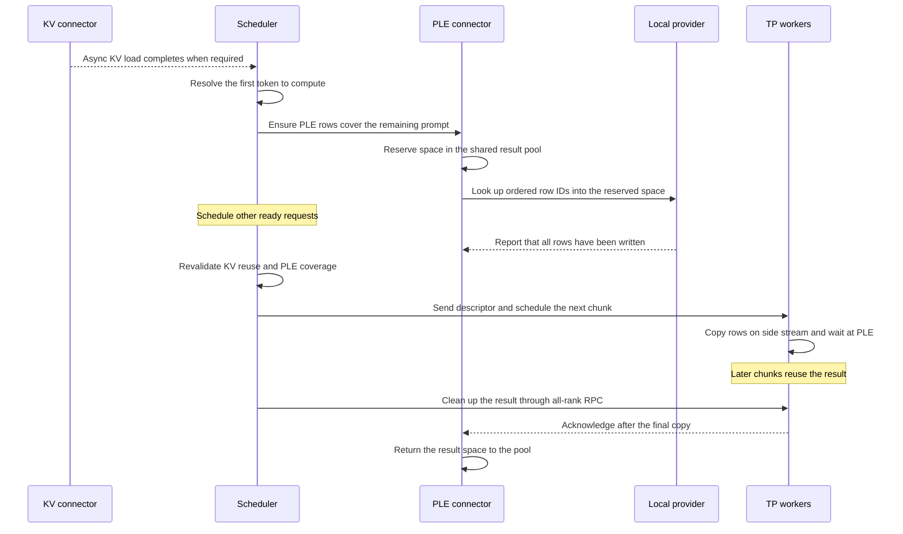

# Scheduler-side PLE preparation

The implementation baseline is vLLM `abf98672c`. The initial provider uses local DRAM. The validation section lists the remaining serving and performance checks.

Qwen4Exp uses a static per-layer embedding (PLE) table indexed by n-gram hashes. The current UVA path lets each GPU read its table shard from pinned host memory. The disk offload path stages rows in the GPU worker after scheduling and before model execution. For prefill, the token IDs are already available in EngineCore, and the scheduler can determine which part of the prompt still requires computation after KV cache reuse.

This design prepares PLE rows asynchronously on the scheduler side after the KV reuse boundary is known. All tensor-parallel (TP) workers on a prefill instance share one prepared host result. Workers copy the rows for their current batch on a separate CUDA stream and wait at the PLE consumer. The initial provider reads from local DRAM. A future provider can fetch the same rows from a remote table service.

## Initial scope

- One Qwen4Exp prefill instance on a single Linux CUDA host, using ModelRunner V2. Bring up TP1 first, then validate TP4. The initial topology uses one data-parallel replica and one pipeline and context parallel rank.
- Text prompts with token IDs, one PLE table, and BF16 or FP8 checkpoint rows. Validate `max_tokens=1` on the prefill instance and run it with speculative decoding disabled. The decode instance uses the existing local UVA backend.
- Chunked prefill, local automatic prefix caching (APC), and external KV connectors that support a separate asynchronous load phase. A synchronous external KV load needs a separate load phase before it can participate in this design.
- An opt-in mode in `EngramConfig` selects connector-backed prefill with the local provider. It requires the supported model, runner, checkpoint and topology. Pool capacity, lookup concurrency, and the lookup deadline are bounded per EngineCore. The default configuration selects the existing embedding backend.

## Component responsibilities

| Component | Responsibility |
| --- | --- |
| Scheduler | Determines the valid KV prefix and the next token that needs computation. Admits the request once its PLE rows are available and builds the batch. |
| `PLEConnector` | Runs in EngineCore. Owns the shared result pool, pending work, prepared token ranges and request deadlines. Submits CPU hashing and lookup work in the background and checks completion on the engine thread. |
| `PLEProvider` | Supplies raw rows from one table bound at startup. It writes them into a buffer supplied by the connector. The local implementation holds the CPU table. |
| Worker `PLEReader` | Maps the local result, takes the slices in the packed batch order, and submits H2D on a copy stream. The Qwen PLE layer consumes the GPU buffer. |
| EngineCore and Executor | Carry descriptors to workers and collect all-rank acknowledgments when the connector reclaims a result. |

The scheduler, connector and local provider share the EngineCore process. A bounded CPU executor runs lookup work without holding the scheduler loop. The multi-rank configuration uses one worker process per TP rank. With a remote provider, EngineCore holds the client and the remote service holds the table.

## Request lifecycle



### Resolve KV reuse before lookup

The PLE readiness check runs in the waiting-request loop in `vllm/v1/core/sched/scheduler.py`. It runs in the compute-admission branch after the scheduler resolves `num_computed_tokens` and applies any replay adjustment, before it allocates slots for new computation. The asynchronous KV load-only branch runs ahead of this check. On completion, `_update_waiting_for_remote_kv()` adjusts the usable frontier for invalid blocks and last-token recomputation. For local APC, the scheduler uses the frontier selected by the current admission attempt. A synchronous external hit returns a request error because that load happens inside worker `pre_forward()`.

The connector prepares `[first_compute_token, prompt_len)`. For an 8,192-token prompt with 6,144 tokens reusable, it prepares 2,048 tokens. The n-gram hash for the first token of the suffix can use up to `ngram_size - 1` token IDs from the prefix. Those IDs supply context while the provider only reads the rows for the suffix. If the scheduler must replay the final prompt token on a full hit, prepare that token's rows.

While the result is pending, the scheduler skips the request and requeues it. The connector assigns a result ID unique within the engine and reserves the destination before submitting the lookup. The scheduler checks the lookup future during admission and uses EngineCore's existing short idle sleep when only background work remains. It publishes the descriptor only if the lookup has completed and the request still needs it.

### Revalidate before dispatch

The scheduler rechecks the KV frontier before admission because an APC candidate can disappear while the request waits. A later frontier uses a subset of the ready result. When the frontier moves back, the connector retires the old result and prepares a single replacement suffix.

Chunked prefill reuses the prepared suffix. On preemption, the worker removes its request descriptor and the connector can retain the result for reuse. Resume rechecks the actual frontier and republishes the descriptor. If a replacement needs more space, it waits for the retiring result to be reclaimed.

### Pass descriptors to workers

The scheduler attaches one descriptor to `NewRequestData` on initial admission and on MRV2 resume. It carries a result ID, its covered token range, and a byte offset into the shared result pool. Workers learn the pool identity and row layout at startup. The existing scheduling metadata supplies the current token count. Workers treat the referenced result bytes as read-only.

Workers use the actual `InputBatch` request order, computed token counts and query offsets to select source and destination slices. For a result covering `[6144, 8192)` and a step covering `[6656, 7168)`, the source starts at token offset 512 in the result and the copy covers 512 tokens. The same local bytes serve all TP workers. Each worker copies its own batch rows to its GPU.

## Table and provider contract

### Bind one table at startup

The model-specific lookup configuration describes the table's checkpoint snapshot, layer, row count, dtype and row width. It also supplies the Qwen4Exp hash parameters and the number and order of heads used to turn token positions into row IDs. Resolve this configuration once and bind the provider to that table for the lifetime of EngineCore. Validate the provider's table identity and layout against the worker configuration before accepting requests. Row IDs are zero-based indices into the bound table.

`LocalPLEProvider` loads one CPU copy per EngineCore from the resolved safetensors snapshot. It fills the table shard by shard to bound temporary memory and stores the rows in checkpoint order as raw bytes in ordinary DRAM. Workers skip the bulk table tensors and load the global FP8 scale and the PLE projection, gate and short convolution weights. Use the existing loader filtering for files containing only skipped tensors and skip the table tensors explicitly in mixed files.

The connector calls a model-specific CPU helper to hash the requested token range, using the same layer numbering, head offsets, hash multipliers and EOS handling as Qwen4Exp, including checkpoint overrides. It flattens the resulting IDs in token and head order. The provider receives this flat sequence and treats every ID as a row in its bound table.

### Write raw rows into a caller-owned buffer

The following sketch shows the proposed internal interface.

```python
class PLEProvider(Protocol):
    def lookup_into(self, row_ids: torch.Tensor, out: torch.Tensor) -> None: ...
```

| Argument | Contract |
| --- | --- |
| `row_ids` | Contiguous CPU `int64` tensor of shape `[R]`. Each ID is within the bound table's row count. The connector skips empty lookups. |
| `out` | Writable, contiguous CPU `uint8` tensor of shape `[R, row_bytes]`. The connector reserves this exact range in the shared pool before lookup. |

On success, `out[i]` contains the raw checkpoint bytes of `row_ids[i]`. For IDs `[7, 42, 7]`, the output contains three rows in that order. This keeps BF16 and FP8 data byte-identical and lets the worker apply the model's usual dequantization. The provider fills the supplied tensor in place and reports incompatible buffers or out-of-range IDs as errors. The connector owns the destination and associates its byte offset with the request's token range.

A future remote implementation can bind the same versioned table at startup and fill the supplied CPU view from a service response. The interface permits direct receive into `out` or a copy from a temporary response. The connector's allocation, scheduling and worker descriptor stay the same in either case.

### Define completion and cancellation

`lookup_into` is synchronous from the caller's perspective. The connector runs it on its background executor and initially serializes calls to a provider instance. A normal return means every row is ready. An exception means the output may be incomplete. Both outcomes end the provider's access to the buffers. A remote implementation must finish or drain any operation that can still write to `out` before returning or raising.

The connector controls when a result becomes visible. It publishes a descriptor only after successful completion for an active request. On a request timeout or cancellation, it discards the result and keeps the reservation until the background call exits. An exception follows the same cleanup path and surfaces as a request error if the request is still active.

Pending, ready and retiring results all count against the connector's byte budget. A request whose required range exceeds capacity fails promptly. A request that can fit may wait for capacity within its deadline. The deadline also bounds the wait for requests that already hold blocks from an asynchronous KV load.

## Worker copies and CUDA Graphs

The connector allocates the shared pool per EngineCore and each worker registers it once for CUDA DMA. Check shared-memory capacity and CUDA registration during startup. The existing encoder-cache `ECSharedRegion` provides a precedent for mapping the same physical region in each TP process. [Shared-memory design precedent](shm_tensor_arena.md)

The worker model allocates fixed-size device staging buffers using `max_num_batched_tokens`. During profiling and graph capture it uses synthetic rows, since worker initialization and memory profiling precede scheduler construction. Real requests use mapped, registered host slices. The copy stream fills the fixed GPU buffer for the packed batch, including defined values for graph padding. The compute stream runs the early layers and waits for the copy at the first PLE consumer. The model continues to perform dequantization, projection, gating and short convolution on the GPU.

Track two separate CUDA dependencies:

1. The connector holds the host result until the last H2D that reads it has completed.
2. The copy stream can overwrite a device staging buffer only after the previous GPU consumer is done with it.

The copy stream records a readiness event before the forward or graph replay. The PLE consumer waits on that event. During graph capture the wait becomes an external event node. Under compilation a custom op waits and reads the rows in a single call. This adds a device copy and prevents compiler functionalization from reading the staging buffer before the wait. The early layers can overlap H2D when the device and workload permit it. Graph replay and event reuse still need CUDA validation. [PyTorch CUDA events](https://docs.pytorch.org/docs/stable/generated/torch.cuda.streams.Event.html)

## Result cleanup

Each result descriptor is dispatched to all worker ranks. On completion or cancellation the connector keeps the allocation record even after the scheduler drops the `Request`. EngineCore batches cleanup checks through the existing all-rank `collective_rpc`, ordered after the last dispatched step that could use the result. It continues to process pending cleanup after the last request finishes.

Each worker returns the result IDs whose last H2D is complete. A rank that has never copied a result can acknowledge immediately. EngineCore intersects the ID sets from all ranks and the connector reuses the bytes only for IDs in that intersection. If the connector cancels a result before dispatch, it can reclaim the bytes as soon as the provider has finished writing. Shutdown drains workers and outstanding provider operations before closing the pool.

Worker request-slot removal drops the local descriptor for finished and preempted requests. The CUDA event remains until that result is acknowledged. Each worker keeps its pool mapping for the lifetime of the instance.

## Implementation and validation

1. **Local provider and correctness.** Add connector-backed Qwen weights loading and the CPU hash helper. Use a small safetensors fixture to compare row IDs and raw bytes with the existing lookup. Cover BF16 and FP8, repeated and out-of-order IDs, invalid IDs and buffers, EOS, suffix boundary context and mismatched table metadata.
2. **Scheduler and TP1 eager.** Wire readiness and descriptors through a real Prefill request. Cover cache miss, local prefix hit, completed asynchronous KV load, KV load failure, chunking, abort during lookup and preemption that exposes earlier tokens. Assert the actual row ranges prepared. Compare model outputs with the local UVA path using the same checkpoint and matched inference settings.
3. **TP4 and CUDA Graphs.** Verify one CPU table per EngineCore, shared result mappings, all-rank cleanup and reclamation after the final request. Replay with different rows and graph padding and compare the consumed rows with the reference. Use a CUDA timeline to verify the H2D overlaps early decoder compute and that the first PLE consumer waits for the right batch. Check reuse of both host and device buffers under repeated and concurrent requests.
4. **Measure with and without KV reuse.** Record PLE lookup queue time, rows and bytes prepared, pool occupancy, PLE wait time, H2D time, TTFT and Prefill throughput. Compare against local UVA at the same model and TP size. A prefix hit should reduce prepared bytes to the recomputed range. Aborted and finished traffic should return the pool to its idle occupancy.
